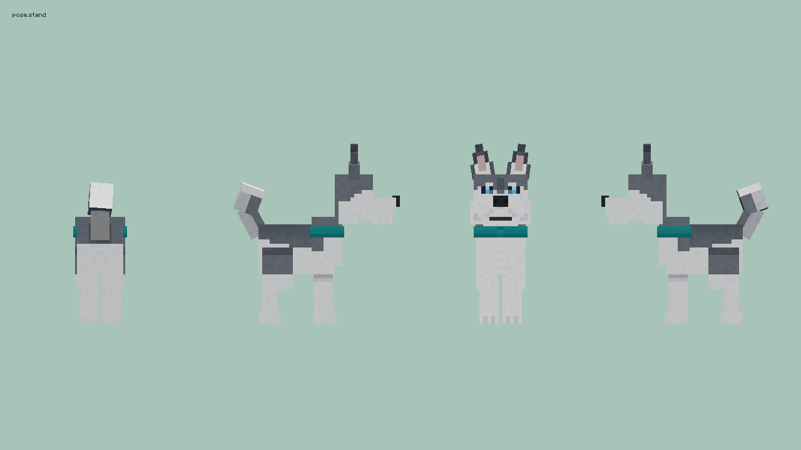
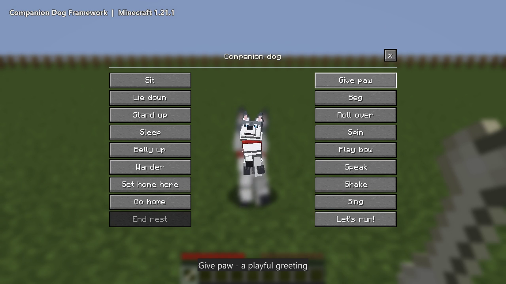
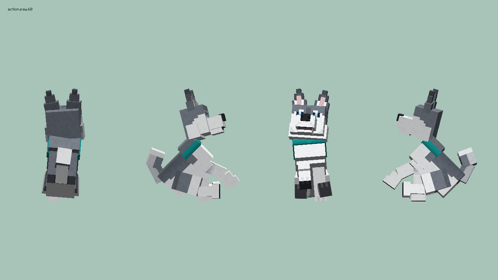
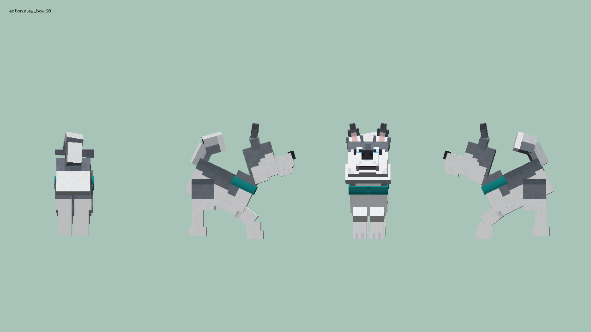

# Companion Dog Framework

A Minecraft companion dog for petting, tricks and games of fetch. Customize its
appearance with a resource pack, or use the source to build your own companion
mod. The accompanying paper explores how personal memorial wishes become game
behavior.



| Players and Mod Makers | Researchers |
| --- | --- |
| [Meet your companion](#meet-your-companion), [make your own dog](#make-your-own-dog), [explore the code](#code-guide) | [Read the paper](#research), [research overview](docs/RESEARCH.md), [citation](#citation-and-rights) |

## Gameplay Showcase

[](https://github.com/crabsatellite/CompanionDogFramework/releases/download/research-v2.0/companiondog-gameplay-showcase.mp4)

**[Watch the gameplay demo](https://github.com/crabsatellite/CompanionDogFramework/releases/download/research-v2.0/companiondog-gameplay-showcase.mp4)**
with English captions. The video is silent.

Welcome your companion, pet, give paw, play bow, feed, fetch a tennis ball,
retrieve a flying disc and settle down to sleep.
[Scene guide](docs/GAMEPLAY_SHOWCASE.md).

## Players and Mod Makers

For **Minecraft 1.21.1**, **NeoForge** and **Java 21**.

### Meet Your Companion

Install the mod on the server and connecting clients. Your collar arrives when
you first join a world. Right-click with it in a safe place to welcome your dog;
use it again to call your companion back to you. A replacement collar can be
crafted with leather, string and a gold nugget.

| Interaction | What to do |
| --- | --- |
| Commands and tricks | Hold a bone and right-click your dog for follow, sit, lie down, sleep, give paw, play bow and other commands |
| Petting | Right-click with an empty hand |
| Feeding | Offer food accepted by vanilla wolves |
| Home | Sneak-right-click with the collar, or choose **Set home here** in the bone menu |
| Fetch | Throw a tennis ball or flying disc; your dog brings it back. An empty-hand right-click also takes a held toy |
| Recovery | Ordinary injuries heal over time. Lethal danger sends your companion home to rest; choose **End rest** after arrival to resume companionship |

The ball bounces; the disc glides. Both share the same retrieval behavior.
[Collar and toy recipes](src/main/resources/data/companiondog/recipe/).

| Give Paw | Play Bow |
| --- | --- |
|  |  |

### Make Your Own Dog

Geometry and textures live in a client resource pack. Ownership, recall, fetch
and recovery stay in the behavior code. The selected appearance applies to all
framework dogs on that client.

1. Start with the [appearance contract](docs/APPEARANCE_CONTRACT.md) and
   [pack template](appearance-pack-template/). Fill in the template's geometry
   and textures.
2. For a new skin, keep the geometry, UV layout and joint pivots. Replace the
   normal texture and optional blink, happy, sleep and collar textures.
3. For a new shape, adjust the rig in `assets/companiondog/appearance/dog.json`.
   Keep the named bone hierarchy and tune joint pivots and mouth sockets for
   the ball and disc.
4. Enable the pack and reload resources. Check each pose and action, ground
   contact, ears, tail, jaw, tongue and held toys. Match the model's size to the
   entity hitbox.

For Blockbench work, follow the hierarchy and coordinates in the appearance
contract, then supply the documented JSON and PNG files. The
[asset generator](tools/generate_default_dog.py) provides a complete example;
the [authoring brief](docs/ASSET_GENERATION_BRIEF.md) is a handoff guide for an
artist or another tool.

### Code Guide

Under [`src/main/java/com/crabmods/companiondog/`](src/main/java/com/crabmods/companiondog/):

- **Interaction and behavior:** `entity/CompanionDogEntity.java` and
  `CompanionDogGoals.java`.
- **Recall and recovery:** `world/CompanionDogBindings.java` and
  `CompanionDogSafety.java`.
- **Ball and disc physics:** `entity/FetchToyEntity.java`,
  `TennisBallEntity.java` and `FrisbeeEntity.java`.
- **Appearance and animation:** `client/model/`.
- **Client/server commands:** `network/`.

### Build

The build scripts require a separately installed managed test runner.
The asset checks run with Python alone:

```powershell
python -B tools/generate_default_dog.py --check
python -B tools/test_default_dog.py
./mod-build.ps1 build
```

The ears and tail can currently clip into the ground during some animations.
See the [technical report](docs/RESOURCE_RELOAD_TEST_REPORT.md) for test results
and remaining issues.

## Research

**[Interpreting Memorial Requirements as Lifecycle Rules: A Design Case of
AI-Assisted Construction](docs/memorial-lifecycle-rules-v2.0.pdf)**

How should a digital companion respond to injury, absence and return? This
retrospective human-computer interaction design case follows the collaboration
between a technical maker and a bereaved pet owner.

The paper examines ordinary healing, protected return, owner-controlled rest,
quiet removal and archival restoration. It traces how these choices shape what
players see, when companionship is interrupted and what can later be recovered.

The framework makes the companion's lifecycle rules available for inspection
and adaptation. The [research overview](docs/RESEARCH.md) connects the design
decisions, implementation and supporting materials.

- [Paper archive and version history](https://doi.org/10.5281/zenodo.23320935)
- [Source and asset provenance](docs/PROVENANCE.md)
- [Changes and releases](CHANGELOG.md)

## Citation and Rights

> Li, Alex Chengyu. 2026. *Interpreting Memorial Requirements as Lifecycle Rules:
> A Design Case of AI-Assisted Construction*. Working paper.
> https://doi.org/10.5281/zenodo.23320935

[CITATION.cff](CITATION.cff) provides machine-readable citation metadata.

Code and generator: [MIT](LICENSE). Game assets: [CC BY 4.0](LICENSE-ASSETS.md).
Paper, documentation and showcase footage: [CC BY 4.0](LICENSE-PAPER.md).
See [license scope](LICENSE-SCOPE.md) and
[third-party notices](THIRD_PARTY_NOTICES.md) for attribution and dependency terms.
